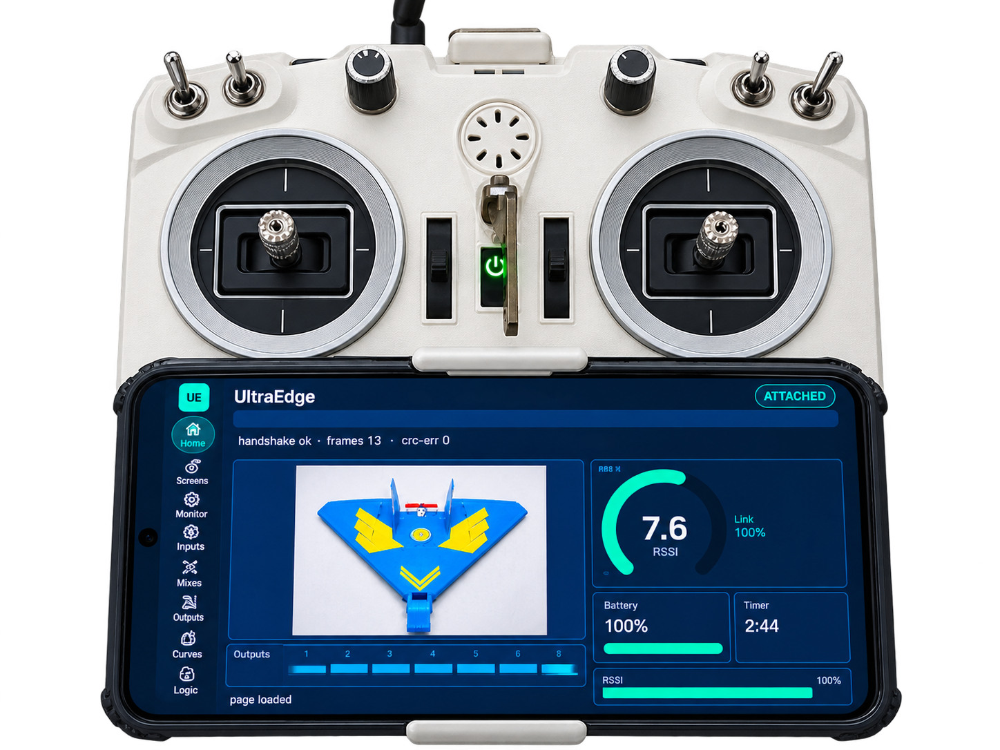

# UltraEdge Companion Protocol

[](LICENSE)
[](LICENSE-SPEC.md)
[](SPEC.md)

UltraEdge is building toward a **modular radio control system**: one where the controls you know — the
feel of your gimbals, your switch layout, your case — can stay in your hands while the interface,
computing and RF evolve. The Android companion is the first practical step, and **UE Protocol is the
documented radio↔companion interface it speaks.** The public specification, reference codec and tests
are a starting point for anyone building a compatible implementation. Today the protocol defines the
radio-to-companion link only; interfaces for UltraEdge's proposed future hardware modules (processing
daughterboard, power, I/O, RF, display) have **not yet been designed**.

Embedded-safe C++11 codec for the radio↔phone link (USB-CDC). Same source compiles
into EdgeTX firmware (Cortex-M) **and** builds standalone for host tests/CI. No dynamic
allocation, no exceptions, no RTTI, no external dependencies.

**The wire format is authoritative in [`include/ultraedge/protocol.h`](include/ultraedge/protocol.h)** —
that header is the spec any implementation must match. The implementer-facing prose spec (framing,
handshake, link-state gating, message catalog, conformance) is in **[`SPEC.md`](SPEC.md)**.

Implementing it elsewhere or embedding it? See [CONTRIBUTING](CONTRIBUTING.md) and add your project to
[ADOPTERS](ADOPTERS.md).

<p align="center"><br><sub>What the protocol enables: the <a href="https://github.com/50UR4V/UltraEdge-app">UltraEdge app</a> driving an EdgeTX radio over USB.</sub></p>

## Status & versioning
The current protocol is **v4** (`PROTO_VERSION = 4`), as used by UltraEdge firmware v1.0.2 and app v1.0.7
or later. Peers negotiate the version in the handshake; match the protocol version and capabilities of
your target release.

## Layout

```
include/ultraedge/protocol.h   public API + wire definitions
src/protocol.cpp               codec implementation
tests/test_protocol.cpp        dependency-free unit tests (own assert harness)
demo/loopback_demo.cpp         mock radio<->phone exchange
  CMakeLists.txt                 standalone build (lib + tests + demo)
```

## Build & test (host)

```bash
# via CMake
cmake -B build . && cmake --build build && ctest --test-dir build --output-on-failure

# or directly, no CMake, no network
g++ -std=c++11 -Wall -Wextra -Iinclude src/protocol.cpp tests/test_protocol.cpp -o test && ./test
g++ -std=c++11 -Wall -Wextra -Iinclude src/protocol.cpp demo/loopback_demo.cpp  -o demo && ./demo
```

## What it provides

- **Framing:** HDLC-style SOF + byte-stuffing, CRC16-CCITT, streaming decoder with resync.
- **Handshake:** `HELLO`/`HELLO_ACK` with proto version + capability negotiation.
- **Messages:** CHANNELS, TELEMETRY, LUA_DATA, KEY, TOUCH, CONFIG_READ/WRITE, AUDIO_EVENT, HEARTBEAT, ACK/NACK.
- **Link state machine** (`LinkManager`): `DETACHED → HANDSHAKING → ATTACHED`, heartbeat timeout, and the central gating decision `companionInputAllowed()` — **the hard requirement that local nav buttons/scroll are inert unless a phone is attached** (no ghost-scroll).

## Safety invariants (enforced by design)

- The codec is pure logic; it never touches the flight-control path.
- Companion input (`KEY`/`TOUCH`/`CONFIG_WRITE`) is gated on `LINK_ATTACHED`.
- Corrupt / oversize / wrong-version frames are dropped, never half-applied.
- Loss of link → `DETACHED` → companion input disabled; the radio keeps executing its active model.

Note that `CONFIG_WRITE` can change model and radio settings, so it is consequential: the radio validates
and applies it, and it is gated on `LINK_ATTACHED`.

## Part of the UltraEdge ecosystem
UE Protocol is the open link these projects speak — see [ADOPTERS](ADOPTERS.md):
- **[edgetx-ue](https://github.com/50UR4V/edgetx-ue)** — EdgeTX fork with the companion overlay (prebuilt firmware for Pocket, Zorro, QX7 & TX16S).
- **[UltraEdge app](https://github.com/50UR4V/UltraEdge-app)** — the Android companion, on **[Google Play](https://play.google.com/store/apps/details?id=com.ultraedge.companion)**.

## License
[](LICENSE)
[](LICENSE-SPEC.md)

- **Code** (reference codec, tests, demo): **[MIT](LICENSE)**. Use it in open-source, closed-source or commercial
  projects. MIT is GPL-2.0 compatible, which is how the same codec builds into the GPL-2.0 EdgeTX-UE firmware.
- **Specification text** ([SPEC.md](SPEC.md) and the docs): **[CC BY 4.0](LICENSE-SPEC.md)**.

*Licence change (2026-10-18): earlier releases of this repository were published under Apache-2.0, and those copies
stay under Apache-2.0. Everything from this point on is MIT (code) and CC BY 4.0 (spec).*

UE Protocol is open and will stay open source. The UltraEdge Android app is a separate, proprietary client that
speaks it.

UltraEdge is an independent project that builds on the EdgeTX community's work; it is not affiliated with
or endorsed by EdgeTX.
